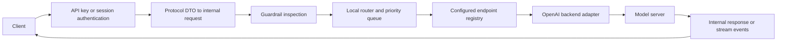
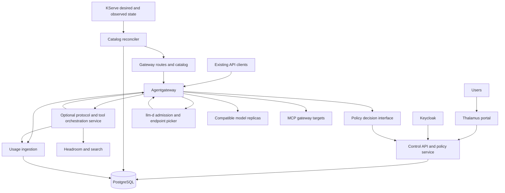

# Thalamus: September 2026 architecture review and development proposal

Review date: 2026-09-04. Status: recommendation for discussion, not an accepted implementation decision.

## Recommendation

Thalamus is salvageable as a source of management-domain code, tests, and requirements. I would **not continue its current backend-centric proxy architecture** or try to finish every partially implemented feature. The migration to KServe/llm-d changes the right ownership boundaries too much.

My recommended sequence is:

1. **Pilot self-hosted Otari in front of the intended llm-d/KServe stack first.** Include the proposed OIDC work, an automated model-catalog reconciler, and trusted classification of requests from their keys/workspaces. This has the best chance of meeting the requirements with a small amount of owned code.
2. **If that pilot fails on substantive requirements, build Thalamus as a portal and policy/control service around agentgateway and llm-d.** Reuse selected management code; let established components carry HTTP, MCP, inference routing, and as much protocol compatibility as they actually support.
3. **Own a custom inference protocol gateway only if the second option exposes a specific, demonstrated blocker.** A full standalone rewrite is the highest-maintenance choice. Rust does not remove the cost of API compatibility, tool orchestration, authorization, and operational correctness.

Keep LiteLLM as the migration fallback. Your operational experience is valid evidence against committing to more LiteLLM-specific infrastructure; this review did not reproduce those production incidents. Do not wait for its Rust migration on the assumption that it will repair policy semantics or OSS feature boundaries.

The investment worth owning is a coherent internal model-access platform: self-service, identity, model publication, workload policy, availability, and useful accounting. The scarce engineering effort should go there before another load balancer.

## What was reviewed and verified

I reviewed the current working tree, including the uncommitted MCP/auth/config changes, at base commit `ba88cc4` (`feat(mcp): add rmcp gateway`, 2026-07-15). The existing edits were preserved. Review inputs included the README, original design in `docs/documentation.typ`, manifests, migrations, bootstrap, request path, scheduler, backend adapter, authentication/provisioning, teams/projects, batch worker, MCP, plugins, UI routes, and test setup.

`SQLX_OFFLINE=true cargo check --locked --offline --all-targets` passed on the available Rust 1.97.1 toolchain. It reported deprecated `rand::thread_rng` calls in test fixtures. This verifies type checking against the checked-in SQLx metadata, not a live migrated database or the declared minimum Rust version. Unit-test results are recorded at the end of this document.

No production cluster, hardware benchmarks, real Keycloak deployment, rendered UI session, or competing gateway deployment was exercised. External capability claims below are documentation/source findings, not interoperability certifications. Moving `main`, `dev`, and `latest` documents are particularly important to distinguish from a pinned release.

## Current architecture: useful structure, incomplete behavior

The code is a modular monolith using Axum/Tokio, PostgreSQL/SQLx, Casbin, optional Redis/Valkey caching, KCL configuration, and Extism/WASM plugins. The frontend is Expo/React Native Web. Feature boundaries are recognizable and repository traits make selective extraction feasible. They are not fully independent domain packages: domain types include SQLx/serde concerns, and application state wires nearly everything together.

The inference path is:

This is a workable prototype. It is not currently a deployable implementation of the new requirements.

| Area | What exists | Assessment for the new platform |
| --- | --- | --- |
| Teams/projects/keys | SQL schema, repositories, hierarchy, CRUD, project-bound keys | Valuable starting material; needs one consistent authorization and policy model |
| Priority | Key/team defaults, five classes, admission slots, aging queues | Relevant idea; replace the scheduling implementation |
| Serving discovery | Startup configuration, endpoint health probes, static model/loading metadata | Replace with model offerings and reconciled Kubernetes deployment state |
| Chat/embeddings | Concrete OpenAI backend adapter and API handlers | Reuse fixtures and limited code after compatibility checks |
| Responses/Messages | Routes, internal rich types, streaming conversions | Much less complete than the route names imply |
| MCP | rmcp transport, registered servers, toolsets, scoped sessions, health/sync | Substantial work; a plausible independently reusable module |
| Guardrails | WASM allow/deny hooks | Does not provide context inspection or request compression as required |
| SSO | OAuth/PKCE state, discovery/userinfo-based OIDC provider | Rework for proper OIDC identity and multi-replica lifecycle |
| Usage | Usage/cost tables, usage fields in DTOs | Recording, aggregation, pricing, and user reporting remain to be built |
| UI | Login/setup and administration for users, teams, keys, signing keys, authorization | Not yet the intended self-service portal; no model catalog or usage screens |
| Operations | Compose, container recipe, CI, logging, tests | Kubernetes deployment and failure behavior remain substantial work |

### Findings that drive the recommendation

**1. Scheduling is local to one process and has lifecycle gaps.** [Registry](../src/features/backends/infra.rs) stores capacity counters in atomics within one gateway; [queue](../src/features/routing/queue.rs) stores waiting requests in local memory. Adding replicas multiplies independently assumed capacity. Queues are shared across models: an unroutable request at the front can stop dispatch for a different model with free capacity. The dispatcher acquires a slot and ignores failed delivery to a disconnected waiter. Expiration happens during dispatch, while the periodic worker only ages entries; queue timeout is not an independent deadline. Fresh arrivals attempt immediate dispatch before checking existing queued work. Non-streaming [proxy operations](../src/features/llm_proxy/domain.rs) release capacity after an await rather than through an acquisition guard, unlike the streaming drop wrapper. These are static control-flow findings; they were not load-tested.

The current aging policy can eventually promote background work into the highest class. It does not express an interactive reservation plus a bounded minimum service share for background traffic. `QueueConfig.priority` and individual queue limits are not a general policy implementation: the manager takes size and timeout from the default queue and uses a fixed enum ordering.

**2. Authentication is not yet a coherent inference policy boundary.** [Priority resolution](../src/features/routing/priority.rs) permits a caller header to override the key/team default. Key/team priority data exists, but project policy and a complete management API for the defaults do not. In the reviewed inference path, authenticated identity is used to choose priority, then `ProxyService` receives only the request and priority. There is no visible model-entitlement enforcement there, and no identity envelope reaches metering or scheduling fairness. The rate limiter is constructed but its middleware is not attached by the application router. Presence of schema fields such as `allowed_models` and budgets does not mean enforcement exists.

**3. Protocol coverage is not sufficient for current agent clients.** [Responses](../src/features/llm_proxy/responses/api.rs) accepts the internal `ChatRequest`, including array-only `input`, and serializes internal `ChatResponse`/`StreamEvent` values directly. It does not implement the native Responses event vocabulary or resource lifecycle. [Messages input](../src/features/llm_proxy/anthropic/dto.rs) restricts each message's content to a string; normal content-block arrays, tool-result turns, and preserved thinking need a different contract. All built-in backend selection currently defaults to the [OpenAI adapter](../src/features/backends/adapter/mod.rs), which targets Chat Completions. Rich internal enums are therefore not proof of end-to-end preservation. The Chat Completions handler terminates on `ResponseDone` without emitting its usage as a final usage chunk.

**4. OIDC needs identity semantics, not another provider switch.** [OIDC provider](../src/features/auth/infra/oauth_providers.rs) fetches discovery and userinfo, but discards the ID token rather than completing ID-token validation. [Provisioning](../src/features/auth/infra/oauth_service.rs) matches by email, leaves provider identity tracking unused, ignores the collected organization list, and gathers roles across memberships when deriving scopes. Login state is process-local. Reuse interfaces and relevant tests, but rebuild around `(issuer, subject)`, validated claims, explicit team versus platform roles, and shared/session-safe state. OAuth linking/unlinking routes are TODOs. This is a readiness finding, not an exploitation exercise.

**5. Batch execution is not safe to scale horizontally.** [Batch repository](../src/features/batch/infra.rs) implements `claim_pending` as a plain SELECT, with processing marked separately. Every application replica starts a worker. The current implementation has no atomic claim/lease or recovery protocol, so multiple workers can process the same job. A durable row is useful, but is not a durable execution system.

**6. Compression cannot be added to the current guardrail ABI as a small hook.** The [guardrail bridge](../src/features/plugin/guardrail_bridge.rs) gives request plugins only the model name and response plugins only model/status; the return value is allow/deny. It cannot inspect prompt content, replace messages, return token estimates, or perform the required asynchronous compression flow. Streaming responses do not pass through the response inspection hook. A plugin exposing both request and response functions is registered for only the first matching kind.

**7. Several advertised operational capabilities are foundations only.** [Usage migrations](../migrations/20250122000001_initial_schema.up.sql) define accounting tables, but no `usage_logs` writer exists in `src`. [Observability initialization](../src/shared/observability/mod.rs) installs formatted tracing logs, not the advertised complete OTLP/metrics pipeline. [Main](../src/main.rs) supplies one initial configuration snapshot to application state, so reloading the [watcher](../src/shared/config/watcher.rs) does not rebuild the live registry/router; additionally, the watcher handle is not retained by its spawned task. Model registration therefore needs more than connecting a file watcher to Kubernetes.

The [Dockerfile](../Dockerfile) also omits the local workspace/plugin crates before its dependency build, despite the manifest requiring them. Treat the container recipe as unverified and likely broken in its present form. Runtime shutdown handles Ctrl-C but has no explicit Kubernetes SIGTERM/drain path; `/health` is unconditional and is not dependency-aware readiness.

**8. The original product rationale has changed.** The original design explicitly favored a backend as the primary entity because one machine could swap multiple models. Under KServe/llm-d, model deployment, actuation, endpoint selection, and hardware placement have their own owners. Keeping the old endpoint registry authoritative would duplicate those owners and create inconsistent state.

The MCP work is worth preserving separately: it uses rmcp and includes tenant/principal-scoped upstream session handling. Runtime stdio registration is currently disabled, with a documented containerization boundary. Its downstream session manager is local, so replica routing, reconnects, credential changes, and rolling restarts still need an explicit contract. Do not interpret the transport enum as proof that every transport is operational. [MCP routes](../src/features/mcp/api.rs), [stdio plan](mcp-stdio-containerization.md).

## Where scheduling should live

There are four distinct decisions:

| Decision | Owner |
| --- | --- |
| Who owns this request; what may it use; what service class applies? | Gateway identity/policy layer |
| May this request enter this model pool now? Which tenant gets service next? | One authoritative inference admission/flow-control layer |
| Which compatible replica/cache should serve it? | llm-d endpoint picker |
| Where do model processes run; which kernels and token batches execute? | Kubernetes/KServe and the model runtime respectively |

Kubernetes pod `PriorityClass` is not per-request LLM QoS. A gateway RPM/TPM limit is not a capacity reservation. Once long generations occupy the serving runtime, merely reordering new HTTP requests cannot guarantee interactive token latency.

The current llm-d **v0.9 documentation** describes feature-gated flow control, priority bands, fairness IDs, bounded queues, and saturation detection. It specifically recommends deriving trusted scheduling metadata upstream from credentials. This is a concrete reason to test llm-d before building a scheduler. Its queues remain in-memory, so durable batch ownership must live elsewhere. The development docs additionally describe in-flight eviction; do not count that as a released, proven capability for your pinned stack. [v0.9 flow control](https://llm-d.ai/docs/architecture/core/router/epp/flow-control), [development flow control](https://llm-d.ai/docs/dev/architecture/core/router/epp/flow-control).

Proposed policy behavior:

- A key is bound to a project and a workload class. Projects inherit team defaults within platform limits. A user may create an agent key and an interactive key without changing client software beyond its ordinary credential configuration.
- Resolve a versioned policy using platform constraints, team allocation, project settings, then the key's permitted default. Caller hints may downgrade service or select an explicitly allowed class; they cannot grant additional priority.
- The trusted boundary removes untrusted scheduling headers and emits the internal objective and fairness identity. Verify that protocol conversion preserves this metadata all the way to the EPP.
- A single key used for indistinguishable interactive and background calls cannot reliably reveal intent. Use separate credentials, configured application identities, or distinct endpoints. Prompt classification and User-Agent heuristics should not decide contractual QoS.
- Define interactive QoS as end-to-end queue/first-token and inter-token latency percentiles for declared prompt/output ranges, not a priority integer. Include compression and search latency when measuring what a person experiences.
- Reserve measured serving capacity for interactive traffic. Initially use separate warm pools/replicas where a hard guarantee matters. Allow background borrowing only with bounded occupancy and a validated reclamation or safe completion strategy.
- Deferrable agent requests may wait longer, but are not automatically interruptible or replayable. Durable batch jobs can retry individual attempts where safe. Never automatically restart a tool sequence or append a replacement generation after client-visible output.
- Add tenant fairness within classes. Do not let creating more projects or keys multiply a team's share. Minimum background progress under sustained interactive load requires an explicit share/reservation policy; strict priority alone does not supply it.
- Decide the EPP outage behavior explicitly. Failing open can preserve availability while losing admission protection. For protected pools, prefer failing closed unless a separately bounded fallback has been validated.

Keep queues shallow at the serving engines so admission decisions remain useful, but do not force a continuous-batching runtime into one-request-at-a-time execution. Tune using actual prompt sizes and KV occupancy. Avoid a long queue in Otari/Thalamus followed by another long queue in llm-d: one layer should own waiting for inference capacity.

## Heterogeneous hardware

Use separate deployment profiles and, initially, separate performance pools for the RTX PRO Blackwell devices, Radeon AI PRO R9700 devices, DGX Sparks, and Ryzen AI Max machines. Those are validation boundaries, not permanent assumptions about which device should serve which workload.

For each model/runtime/device combination, record image digest, CPU architecture, accelerator resource and driver stack, model revision, quantization, tokenizer/chat template, supported API capabilities, usable context, cold-start time, prompt/decode throughput, and saturation curves. Include large-context requests and cancellation behavior. Derive eligible classes from measured performance, rather than GPU branding or memory size.

llm-d lists NVIDIA and AMD/ROCm support, but explicitly delegates specific GPU capability to the inference image. Vendor-level support is not certification of your exact workstation/APU/ARM image matrix. A runtime can be managed by Kubernetes while supporting only basic HTTP routing rather than every llm-d optimization. Preserve that simpler path for devices that cannot expose the required telemetry or cache APIs. [Accelerator support](https://llm-d.ai/docs/getting-started/accelerators).

Do not assume mixed-vendor distributed tensor parallelism, portable KV caches, or cross-device prefill/decode transfer. Start with independently serving replicas and tested compatibility boundaries. Different quantizations may be separate offerings when quality or behavior differs; never silently treat every deployment bearing the same upstream model name as interchangeable.

## Model publication and availability

Make **model offering** the user-facing identity, and **model deployment** the serving realization. The proposed vocabulary is in [CONTEXT.md](../CONTEXT.md).

The desired workflow is: submit one deployment/catalog declaration through GitOps or an API backed by the same desired state, then see it appear with capabilities and status. No second hand-maintained LiteLLM-style model list.

A small controller should watch the selected version of KServe resources and the generated route/pool resources, reconcile only explicitly published models, and update a read model used by the portal and gateway. Do not assume every KServe resource kind exists in every installed version. Establish which fields are authoritative: deployment intent in GitOps/KServe, identities and team/project policy in the platform database, observed availability in the catalog projection. The controller must handle initial listing, watch reconnection/relist, resource UID changes, stale status, and deletion. Kubernetes requests stay off the per-inference hot path.

Publish a stable `/v1/models` view for permitted offerings plus a richer portal API for limits, modalities, tooling, recommended applications, status, and status freshness. A temporary readiness failure must not remove the model identity. A ready pod is also not sufficient proof of a working inference route: combine service conditions with bounded serving probes and observed failures.

Suggested availability contract:

| State | Client behavior |
| --- | --- |
| Unknown or unpublished offering | Protocol-appropriate not-found response |
| Unauthorized offering | Explicit authorization behavior consistent with catalog visibility policy |
| Ready | Dispatch normally |
| Degraded | Route to eligible healthy capacity; display degradation |
| Starting/loading | Bounded wait when permitted, otherwise retryable unavailable response |
| Temporarily unavailable | Structured 503-class error with reason and retry guidance |
| Overloaded or quota-limited | Distinguish saturation, queue deadline, and policy limit; preserve 429/503 semantics |
| Draining | Stop new placement and allow bounded completion |
| Status stale/unknown | Display uncertainty and apply a defined conservative routing policy |

Include `Retry-After` when a reasonable retry interval is known, a request ID, and a machine-readable reason. Do not invent an ETA. Infrastructure startup and transient readiness should have distinct reasons so operators can distinguish loading from a crash or missing image.

llama-swap's `sendLoadingState` option really does insert loading text into reasoning fields. Borrow the explicit lifecycle, but keep synthetic reasoning out of the default compatibility path. It can pollute conversation history and interfere with preserved/signed/opaque reasoning. Use status UI and supported out-of-band progress; SSE comments or ping events can keep a connection alive only where the protocol/client permits them, and do not reliably produce visible progress. For opt-in UI integrations, use a separately identified status event. [llama-swap configuration](https://github.com/mostlygeek/llama-swap/blob/main/docs/config.example.yaml).

Scale-from-zero also needs an actuation owner and a coalesced wake-up request; a catalog watcher cannot itself load a model. Keep latency-critical offerings warm. Add on-demand loading after the deployment/runtime path proves it works.

## Protocols, tools, and compression

Treat protocol fidelity as a first-class product requirement. Native pass-through should preserve unknown fields, content blocks, usage, cancellation, and opaque reasoning whenever the backend supports the client's protocol. When translating between formats, publish an explicit capability subset, reject unsupported features clearly, and test actual clients. Do not force all traffic through one lossy universal DTO.

A route named `/v1/responses` does not imply support for storage, continuation IDs, background requests, cancellation, or native server tools. Pick a supported subset deliberately. Stored Responses can be deferred only if the real clients do not require them; otherwise include their ownership, retention, and lifecycle in the MVP.

**MCP federation and gateway-run tools are separate products.** A gateway that lists and proxies MCP tools does not automatically implement a model/tool/model loop or native web-search result blocks. For local models, someone must translate the request, invoke search, return tool results to inference, aggregate attempts and usage, and emit the correct response events and citations. Preserve tool IDs and distinguish client-run calls from gateway-run calls. Provider-hosted search cannot be conjured by forwarding a vendor-specific tool name to vLLM.

Start with read-only web search, bounded rounds, execution time, result size, and a search backend selected by project policy. Release inference capacity while waiting on tools, then re-enter admission for the next model call using the same principal and class. Attribute every internal generation and tool invocation to the outer request. Reuse an existing implementation if its observable behavior matches your clients.

Otari documents gateway-run tools across Chat Completions, Messages, and Responses, including interception of native search types and configured search providers. This is a material advantage over merely having an MCP endpoint, but still needs local-model/client acceptance tests. [Otari tools](https://github.com/mozilla-ai/otari/blob/main/docs/tools.md).

For compression, introduce an asynchronous request-transformation interface with full permitted content, capability metadata, deadline, cancellation, and a returned transformed request plus measurements. Run cheap validation before it. Invoke Headroom as a separately deployable service/library boundary; do not port its machinery to Rust or constrain it to the present WASM ABI.

The trigger should consider the selected deployment's actual context budget minus output reserve and protocol overhead. Recount after transformation; if the request still cannot fit, return a clear context-limit error. Compression is not guaranteed to fit arbitrary input without losing useful information.

Headroom documents a compression-only API and a marker-free default mode suitable for gateways. Retrieval-marker mode requires a functioning retrieval-tool path. Preserve stable cached prefixes and opaque thinking/tool structure, version the transformation, and measure answer quality and end-to-end latency as well as token reduction. Compression may cost more time than it saves on short requests. [Headroom proxy and compression API](https://github.com/headroomlabs-ai/headroom/blob/main/docs/content/docs/proxy.mdx).

## Self-service, identity, and accounting

The portal MVP needs a Keycloak login, current team/project context, permitted-model catalog, create/revoke/rotate own keys, last-used/expiry information, policy visibility, and usage grouped by project/model/class. Team admins should manage their own membership and project allocation; platform operators should manage infrastructure. Do not expose Casbin policy internals as the normal user's workflow.

Use validated OIDC identity keyed by issuer and subject. Define group-to-team mapping, removal/deactivation behavior, role refresh, session expiry/logout, and key revocation propagation. A reverse proxy login alone does not implement application membership and authorization. Keep browser sessions separate from automation credentials. Use one policy decision shared by inference, tool access, catalog filtering, and key issuance; verify permissions on every management operation as well as navigation.

Keep PostgreSQL for durable identity, policy, catalog projection, and usage. A cache can accelerate key decisions, with explicit invalidation or a documented bounded revocation delay. Avoid adding Kafka or a new event platform just for basic accounting.

Record an outer request and its individual attempts with user/team/project/key, offering/deployment, class, policy version, status, timestamps, queue/first-token/total latency, input/output/cache/reasoning usage where available, tool calls, and compression before/after counts. Distinguish reported from estimated and missing usage. A canceled stream may not deliver a final token count; do not report missing counts as exact zero.

Use idempotent usage ingestion and a bounded, monitored delivery path. A queue in process memory alone is not durable accounting. Choose explicitly whether a durable spool/outbox is required or whether bounded loss is acceptable; report ingestion lag and gaps. Keep raw prompts out of default basic usage records and use a separate controlled diagnostic retention policy if needed.

Store **reference spend** separately from actual infrastructure cost. Version the comparison model and prices, support input/output/cache/tool categories without double-counting provider totals, and preserve the underlying token measurements so reports can be repriced. Show the comparator explicitly; a local quantized model is not automatically equivalent to a frontier API. If estimating avoided external spend, exclude duplicate failed attempts or show them separately from physical consumption. Capacity budgeting should continue to use actual resource demand even if reference prices change.

## Alternatives and remaining work

| Option | Strongest fit | Material remaining work | Judgment |
| --- | --- | --- | --- |
| Existing LiteLLM OSS | Existing clients, configuration, broad integrations | Your observed reliability issues; exact OSS SSO/self-service limits; catalog sync; trusted QoS integration | Transitional baseline; not my default new investment |
| Self-hosted Otari + llm-d/KServe | Self-service-oriented management, usage, gateway-run tools | OIDC contribution and lifecycle; project mapping; discovery; trusted scheduling metadata; release validation | First adoption pilot |
| agentgateway + Thalamus control service/portal | Kubernetes inference integration, MCP, programmable auth boundary, Rust data plane | User portal, owned policy/usage integration, catalog controller, any missing server-tool semantics | Preferred custom-platform route |
| Bifrost OSS | Go gateway, management UI, provider and governance features | End-user workflow; OIDC/provisioning entitlement; Kubernetes policy/discovery integration | No demonstrated advantage over the two finalists for these requirements |
| Evolve old Thalamus wholesale | Full ownership and familiar code | Most critical serving, identity, accounting, and operational paths need redesign | Poor return on preserving current architecture |
| Full new gateway from scratch | Complete freedom | Entire API and operational maintenance burden | Only after a concrete integration blocker justifies it |

**Otari:** the supplied documentation site links to `mozilla-ai/otari`. Its current access-control docs describe organizations/workspaces, key-bound workspace attribution, and own-key management for members. That can map to your teams/projects, but verify the permission hierarchy rather than renaming labels blindly. The documented OAuth providers are Google/GitHub; the unprovided OIDC PR is not counted as shipped. [Access control](https://github.com/mozilla-ai/otari/blob/main/docs/access-control.md).

Its architecture document explicitly labels itself a target architecture with some seams and surfaces still planned. Evaluate the self-hosted image and source revision, not screenshots of hosted otari.ai or the target capability table. Its Python/any-llm foundation is not by itself a reason to reject it; measure reliability, streaming memory, UI responsiveness, and upgrade effort. [Otari architecture](https://github.com/mozilla-ai/otari/blob/main/ARCHITECTURE.md).

**Agentgateway:** it already documents using the llm-d EPP through `InferencePool`, including a path combining an AI backend with the pool so LLM policies can coexist with endpoint selection. This is materially different from a generic HTTP gateway that needs a bespoke Kubernetes router. The published example is not proof that your chosen llm-d flow-control feature gate, parser, and stream lifecycle work together; make that a pilot gate. [Inference routing](https://agentgateway.dev/docs/kubernetes/latest/llm/inference/inference-routing/).

Its external authorization interface provides a plausible integration boundary for an owned policy service. It still does not replace a self-service product, and an MCP federation feature should not be counted as local web-search orchestration without testing that path. Keep its admin interface operator-only. [External authorization](https://agentgateway.dev/docs/kubernetes/latest/security/extauth/byo-ext-auth-service/), [MCP and inference overview](https://agentgateway.dev/docs/kubernetes/latest/).

**Bifrost:** it is Go-based, not Rust-based. Its OIDC user provisioning, including Keycloak, is explicitly documented under Enterprise. That is directly relevant to avoiding another feature-entitlement mismatch. Verify the exact MCP/guardrail/HA boundary too: do not extrapolate the enterprise feature list to OSS. [Repository](https://github.com/maximhq/bifrost), [OIDC provisioning](https://docs.getbifrost.ai/enterprise/user-provisioning).

**LiteLLM:** self-service keys and own-spend views do exist; they should not be scored as missing. The current SSO documentation says it is free for up to five users from v1.76.0 and otherwise presents it as Enterprise. That is a more precise limitation than saying OSS has no SSO. It does not resolve an organization-scale Keycloak requirement or your reliability experience. [Self-service](https://github.com/BerriAI/litellm-docs/blob/main/docs/proxy/self_serve.md), [SSO](https://github.com/BerriAI/litellm-docs/blob/main/docs/proxy/admin_ui_sso.md).

Upstream now has Rust work in the main repository; the separate LiteLLM-Labs project describes itself as a proof of concept. This is useful architecture material, not evidence that a Rust path has complete feature parity or repairs your operational experience. Compare the exact deployed artifact if revisiting it. [Main repository](https://github.com/BerriAI/litellm), [Rust announcement and follow-up](https://github.com/BerriAI/litellm/discussions/29478).

## If Thalamus is developed: target shape and salvage plan

The optional tool service uses a dedicated internal inference route and authenticated identity propagation; it must not recurse through its own public orchestration route. Ordinary requests should not traverse it. The exact protocol/mutation integration is a spike deliverable, not an assumed agentgateway plugin capability.

Start as one control-service binary with clear modules and a separately run reconciliation/worker role when needed. The diagram shows responsibilities, not a requirement to create a microservice for every box. The data plane and long-lived inference streams remain separately deployable. Do not build a Kubernetes CRD per user or key.

| Existing part | Action |
| --- | --- |
| Teams, memberships, projects, SQLx repositories | Extract and simplify; correct role semantics and transactional boundaries |
| API-key generation/storage, rotations | Reuse selectively after ownership, scope delegation, revocation, and cache review |
| Test fixtures and mock backends | Preserve; extend into black-box protocol and lifecycle contracts |
| MCP toolsets/registration/scoped sessions | Retain domain/API ideas; choose either rmcp service or agentgateway federation as the protocol owner |
| PostgreSQL migrations | Use as reference; forward-migrate deployed data, otherwise establish a clean v2 schema |
| UI workflows and query/service code | Salvage relevant flows; implement the missing self-service product |
| Local registry/router/priority queue | Retire once llm-d admission and placement are validated |
| Universal wire DTOs and adapters | Replace as the default path; salvage tested translations only |
| WASM plugin architecture | Defer; first implement narrow async transformation/tool interfaces |
| Embedded KCL runtime | Remove from the serving/control hot path; use ordinary configuration and Kubernetes resources; KCL may remain an optional build-time authoring tool |
| Broad bespoke authentication suite | Prefer Keycloak and opaque workload keys; retain other modes only for a demonstrated requirement |

A web-only frontend would remove Expo/native-platform integration work, and the original design says native applications are not planned. I would choose a conventional React web stack for a new portal. I would not schedule a cosmetic rewrite of functioning screens before policy and self-service contracts exist. The current UI has not been browser-profiled, so its framework is not being blamed for measured slowness.

Create a clean v2 workspace/branch and bring useful code across with explicit review. Preserve the old implementation and its dirty working tree as reference. Do not rewrite migration history if any deployed environment uses it. This is a selective restart of the product architecture, not a line-for-line rewrite.

## Delivery plan and decision gates

The estimates below are planning judgments for one experienced platform/backend engineer with timely access to the cluster and frontend help where needed. They exclude cluster migration, device-driver enablement, model qualification, upstream review queues, and broad vendor API parity. Re-estimate after the first pilot; engineering weeks are not a calendar promise.

| Stage | Deliverable and exit gate | Indicative effort |
| --- | --- | --- |
| 0. Baseline and pin | Client/protocol inventory, model/runtime matrix, explicit interactive SLOs, versions/image digests, representative sanitized workload replay | 0.5–1 week |
| 1. Adoption pilot | Otari + Keycloak branch + model reconciler proof + trusted class/fairness mapping + llm-d flow control; exercise self-service and search | 1–2 weeks |
| 2A. Adopt if sufficient | Harden only the integration seams; production release and upgrade rehearsal | 2–4 additional weeks, depending on OIDC readiness |
| 2B. Custom platform if needed | Thin Thalamus control API + agentgateway/EPP vertical slice; prove auth/mutation/tool boundaries before expanding UI | 1–2 weeks for the architecture spike |
| 3B. Core owned platform | OIDC, teams/projects, keys, model catalog/status, usage, basic portal, consistent policy | 4–8 additional weeks |
| 4B. Required compatibility and operations | Search loop if missing, compression, batch leases if needed, protocol/client tests, HA/draining and failure tests | 3–6 additional weeks; can exceed this if clients require broad Responses statefulness |
| 5. Optional lifecycle UX | Scale-from-zero/wakeup, rich progress integration, more dynamic borrowing and scheduling refinements | Estimate after runtime behavior is measured |

The custom route is a multi-month product effort with recurring maintenance. Budget an owner for protocol changes, upgrades, telemetry, and incident response. A full standalone replacement should be expected to cost more than this composed-platform estimate.

Use these same acceptance gates for Otari, agentgateway composition, or a custom gateway:

1. **No special client headers:** two normal keys attached to different classes produce different observed service under saturation. A trusted policy change is visible within a declared propagation bound. One team cannot gain fairness share by multiplying keys/projects.
2. **Interactive protection:** replay short interactive bursts with large-context and long-output background work already running. Measure p50/p95/p99 queue time, end-to-end TTFT, inter-token latency, throughput, and errors per class and hardware pool. Choose numeric SLOs from your workloads before running the test. Include a sustained overload period and verify both interactive protection and the agreed background minimum.
3. **Actual clients:** normal multi-turn chat, streamed and non-streamed tool calls, tool results, cancellation, native search blocks/citations, reasoning preservation, embeddings, and every Responses lifecycle feature the selected clients use. Use synthetic conformance fixtures plus real local models; passing one does not imply passing the other.
4. **Kubernetes lifecycle:** publish one model, roll a revision, scale down, delay startup, remove a pod, make observations stale, restore them, and retire the offering. No manual second model list and no false permanent disappearance during temporary degradation.
5. **Self-service:** a normal Keycloak member signs in, sees only permitted models/projects, creates and rotates a key, views only authorized usage, and loses access according to the documented deprovisioning policy. Team administration and platform administration remain distinct.
6. **Multiple replicas and failures:** run at least two gateway replicas; interrupt the EPP, roll the gateway, interrupt the usage sink, and restart batch workers. Verify admission bounds, stream drain behavior, accounting gaps, and duplicate-attempt handling. Batch ownership must survive a worker crash without silently producing duplicate final results.
7. **Compression value:** compare answer quality, input-token savings, prefix-cache behavior, and total latency on representative long requests. Enforce a bounded compression deadline and explicit behavior when it fails or cannot fit the input.
8. **Operational clarity:** a single request ID links policy/class, offering/deployment, queue decision, protocol path, tool attempts, final status, and usage. The operator can explain a slow request without enabling broad prompt logging or reading gateway internals.

If Otari passes these gates with a small reconciler and upstreamable policy/OIDC changes, stop and adopt it. If it requires invasive recurring patches to identity, protocol semantics, and routing, switch to the composed Thalamus path. If agentgateway cannot support a required transformation or tool lifecycle through a stable boundary, build that narrow service first; only take ownership of the entire proxy when that genuinely reduces total complexity.

## Migration

Keep the existing LiteLLM endpoint and keys operational during the pilot. Deploy the candidate under a separate endpoint against the same serving stack with explicit test allocations so comparisons do not steal interactive production capacity. Use synthetic/sanitized replays; do not shadow side-effecting agent/tool work.

Publish equivalent model aliases and compare usage records before moving users. Reissue scoped keys rather than assuming one product's key hashes can be imported into another. Migrate a low-risk project, then selected interactive users, then durable batch. Keep rollback as an endpoint/credential change until cancellation, accounting, and an upgrade cycle have been observed in operation.

## Verification results

- All-target offline type check: passed; test-fixture deprecation warnings only.
- Library unit tests: `SQLX_OFFLINE=true cargo test --locked --offline --lib` was attempted, then interrupted during the lengthy KCL/WASM dependency compilation (exit 130). No test results were produced; this is not a failing-test result or a passing test suite.
- Database integration, browser, container, Kubernetes, hardware, and competing-product acceptance tests: not run as part of this review.
- Report validation: local Markdown link targets exist and diagram code fences are balanced. No application code was changed for this review.
